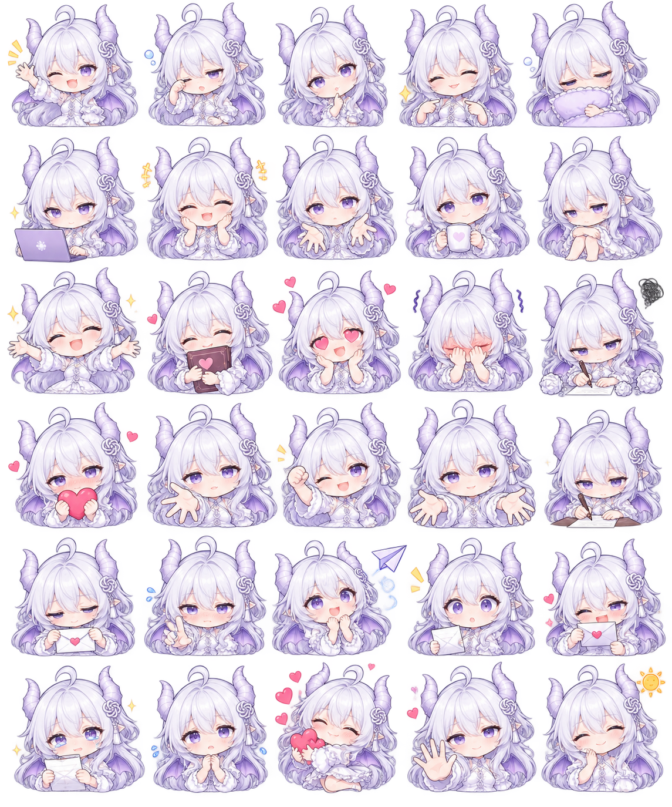

# Codex 龙娘表情包 Skill

30 张透明背景龙娘 Q 版表情，让支持本地图片显示的 Agent 根据回复语气配图；含随机选择与最近三张去重，运行脚本仅依赖 Python 标准库。

Created by **Micker / Ghoscro × C.C. (Codex)**, as part of the Micker Method.



[来源 MV《致你》](https://www.bilibili.com/video/BV14BpQ6mEPj/) · [MV 可编辑工程](https://github.com/Ghoscro/dear-you-mv)

## 安装

把仓库放到 Agent 的技能目录，目录名保持 `codex-dragon-stickers`。例如 Codex：

```sh
git clone https://github.com/Ghoscro/codex-dragon-stickers.git ~/.codex/skills/codex-dragon-stickers
```

Windows PowerShell 可用 `$HOME/.codex/skills/codex-dragon-stickers`。已有同名目录时先自行备份，勿覆盖自己的修改。重新开启会话或按宿主方式刷新技能，然后说「用 codex-dragon-stickers 给回复配表情」。自动启用行为由宿主决定。

## 试用

在 Skill 目录运行：

```sh
python -X utf8 scripts/stickers.py auto 开心
python -X utf8 scripts/stickers.py pick 思考
python -X utf8 scripts/stickers.py list
```

脚本返回当前机器的绝对图片 Markdown，可直接用于支持本地图片的对话。`assets/gallery.html` 可本地浏览所有表情。某些聊天平台无法显示本地文件，需使用该平台的附件上传功能。

`SKILL.md` 包含配图规则；`auto` 按语气随机并避免近期重复；`pick` 指定表情。状态仅保存近期表情 ID，不保存聊天。用户要求纯文本时不配图。此 Skill 不导入人物人格、私人记忆或关系设定。

## 许可

MIT，适用于贡献者可授予的代码、文档和图像权利。图片来自用户提供的 AI 生成图集，已授权本次公开分享；保留透明边缘与独立小装饰。AI 素材的排他权及第三方标识权利未作保证。

本公开包排除了私人对话、记忆、凭据和部署信息。
